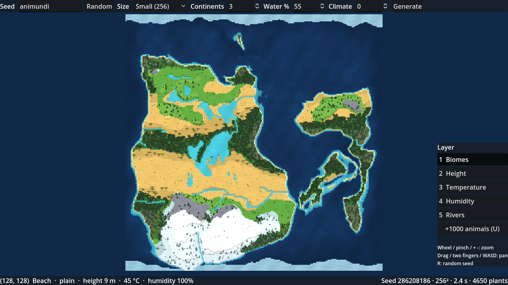
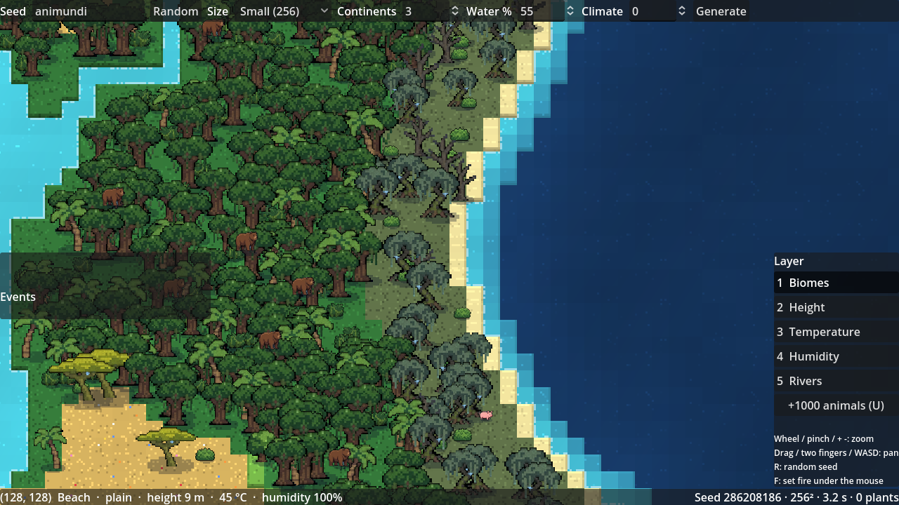
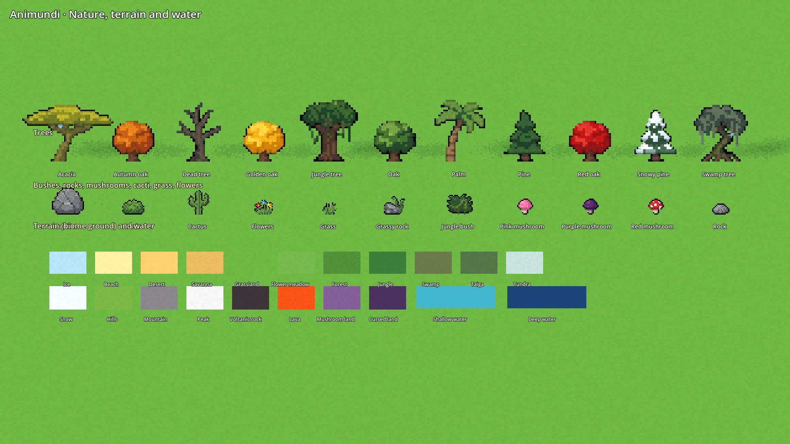
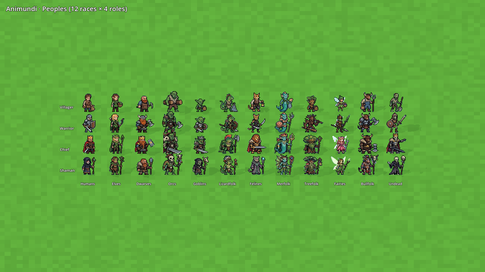
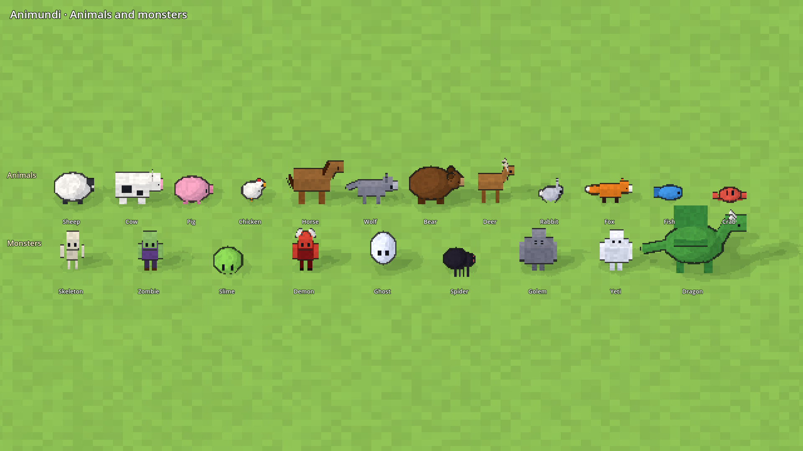

# Animundi

*Anima mundi*: the soul of the world.

A top-down pixel-art god sandbox. You shape a world, drop in peoples, animals and monsters, then watch history write itself.

The twist: every people, monster species and force of nature (forest, volcano, ocean…) is driven by a small AI running locally on your machine. It invents its own culture: items, rituals, laws, architecture, and even the code of its own inventions, written in a small in-game language.

## Status: 0.15 2D core (in progress)



The world is a **flat 2D map drawn as one texture, one texel per tile**, scaled up with sharp pixels: the whole map costs one draw call whatever its size, the way WorldBox does it. Each tile has its biome colour, lighter on higher levels, with a slight variation so big biomes are not one flat colour. Zoomed in, a shader cuts each tile into 8×8 pattern pixels and draws a light ground pattern (grass, forest floor, sand ripples, snow sparkles, rock, glowing lava, water glints) and **step edges** where the ground goes down a level: a dark cliff face on the south side, darker lines on the sides, a light rim on the north. Zoomed out, patterns fade and the map reads like a map.



Every world is generated from a seed with **tectonic plates**: continents grow from clusters of plates, mountain chains rise where plates collide, island arcs form where ocean plates meet, and warped noise gives ragged coasts (see [docs/MAP_GENERATION.md](docs/MAP_GENERATION.md)). Then come climate (latitude, altitude, winds and rain shadows), rivers and lakes, five terrain levels, and natural biomes in large regions. Special biomes (volcanoes, mushroom lands, cursed lands) are never generated at random: they will be placed by the player with the terrain tools (0.16).

Plants (trees, bushes, rocks, cacti, mushrooms, flowers) are scattered over the map by biome from the seed, and **drawn in batches**: every sprite is packed into one atlas texture at start, and all of them go into a few MultiMeshes, one per strip of 16 tile rows, sorted by the height of their feet so nearer sprites cover the ones behind. A 512 world draws its ~22,000 plants in a few dozen MultiMeshes instead of 22,000 draws. Each sprite has a small drawn shadow (no real-time lighting). Flowers hide when zoomed out.

Next in 0.15: zoom-dependent detail (units as dots from far), animated water and wind sway, the C# simulation core. The 0.1 3D pixel-art view ([screenshot](docs/images/world_0.1.png)) is retired; its builders in `scripts/render3d/` are still used by the asset sheet tool, and `sprite_library.gd` there sets the sprite sizes.

## Asset sheets

Every sprite, drawn in the game's 3D world with its own look (regenerate with `tools/asset_sheet.gd`):

| Nature, terrain, water | Peoples | Animals and monsters |
|---|---|---|
|  |  |  |

```bash
godot --path . --script res://tools/asset_sheet.gd -- <nature|peoples|creatures> <out.png>
```

## Running the game

Requires [Godot 4.3](https://godotengine.org/download) (standard version, not .NET) and a GPU with Vulkan (the game uses the Forward+ renderer).

1. Open Godot, click **Import**, and pick `project.godot` in this folder.
2. Press **F5** to run.

Controls:

| Action | Input |
|---|---|
| Zoom (toward the mouse) | mouse wheel, trackpad pinch, + / - keys |
| Pan | drag with any mouse button (or click and drag on a trackpad), trackpad two-finger scroll, WASD, arrow keys |
| New random world | R or the **Random** button |
| Map layers | 1 Biomes · 2 Height · 3 Temperature · 4 Humidity · 5 Rivers |
| Tile info | hover the map (bottom bar) |

Type any word or number as the seed: the same seed and settings always give the same world.

## Project layout

| Path | Content |
|---|---|
| `scripts/world/` | world settings, data, the generator (shape → climate → hydrology → biomes) and flora placement |
| `scripts/render2d/` | the world map (one texture, one texel per tile), the sprite atlas and sprite batches |
| `scripts/render/` | 2D map renderer (preview tool) and data layer colours |
| `scripts/render3d/` | retired 0.1 3D view (terrain, water, vegetation builders), still used by the asset sheet tool |
| `scripts/ui/` | map camera, HUD, and the 0.1 pixel camera |
| `shaders/` | `map.gdshader` (ground patterns and step edges), `sprite_batch.gdshader` (atlas sprites); the others belong to the retired 3D view |
| `scripts/core/` | seeded random streams, priority queue |
| `scripts/generated/` | files written by `art/sprites.py`, do not edit |
| `assets/tiles/` | terrain atlas used by the game |
| `assets/sprites/` | game sprites (trees, plants, peoples, races, animals, monsters), cut by `art/extract_sprites.py` |
| `art/` | reference sheets (`reference/`), sprite extraction script, old 8×8 sprite generator (not imported by Godot) |
| `tests/` | headless tests |
| `tools/` | headless preview renderer, screenshot and asset sheet tools |
| `docs/` | game design and research |

## Tests and tools

```bash
godot --headless --path . --import
```

```bash
godot --headless --path . --script res://tests/test_world.gd
```

```bash
godot --headless --path . --script res://tools/render_preview.gd -- <seed> <size> <out_dir>
```

Screenshot of the game (needs a display; on a headless machine wrap it in `xvfb-run`). `zoom` is screen pixels per world pixel, a tile being 8 world pixels; 0 shows the whole map:

```bash
godot --path . --script res://tools/screenshot.gd -- <out.png> [seed] [zoom] [volcano]
```

To re-cut the game sprites after editing a reference sheet (Python 3, Pillow, NumPy, SciPy):

```bash
python3 art/extract_sprites.py
```

The old 8×8 sprites and the 2D terrain atlas used by the preview tool are generated by:

```bash
python3 art/sprites.py
```

## Direction

Animundi is **built like WorldBox** (flat 2D map drawn as one texture, sprites drawn in batches, data-driven content, batched simulation in C#) and **different where it matters**: local AI minds that invent objects, buildings and ways of life, and make them evolve over generations. Version 0.1 was a 3D pixel-art prototype; the game moved to the 2D approach in 0.15 (see [docs/ROADMAP.md](docs/ROADMAP.md)).

## Design

- [docs/GAME_DESIGN.md](docs/GAME_DESIGN.md): everything the game must contain and how it is generated.
- [docs/GOD_GAMES_RESEARCH.md](docs/GOD_GAMES_RESEARCH.md): what other god games let you do, and what Animundi takes.
- [docs/ROADMAP.md](docs/ROADMAP.md): the steps to 1.0, ticked as they land.
- [docs/WORLDBOX_ANALYSIS.md](docs/WORLDBOX_ANALYSIS.md): how WorldBox is built, and what Animundi takes from it.
- [docs/WORLDBOX_WIKI_LESSONS.md](docs/WORLDBOX_WIKI_LESSONS.md): what makes a good sandbox god game, from a study of the WorldBox wiki, and what it means for Animundi.
- [docs/MAP_GENERATION.md](docs/MAP_GENERATION.md): how worlds are generated (tectonic plates, climate, biomes) and the other algorithms looked at.
- [docs/ART_DIRECTION.md](docs/ART_DIRECTION.md): the look of the game (flat 2D pixel art, built like WorldBox) and the history of the 3D prototype.

Engine: Godot 4.3.

## Next steps

See the milestones in [docs/GAME_DESIGN.md § 23](docs/GAME_DESIGN.md#23-milestones). Now: **0.15 2D core** (see the roadmap), then **0.2 Life** (flora spreading, generated animal species, food chains).
