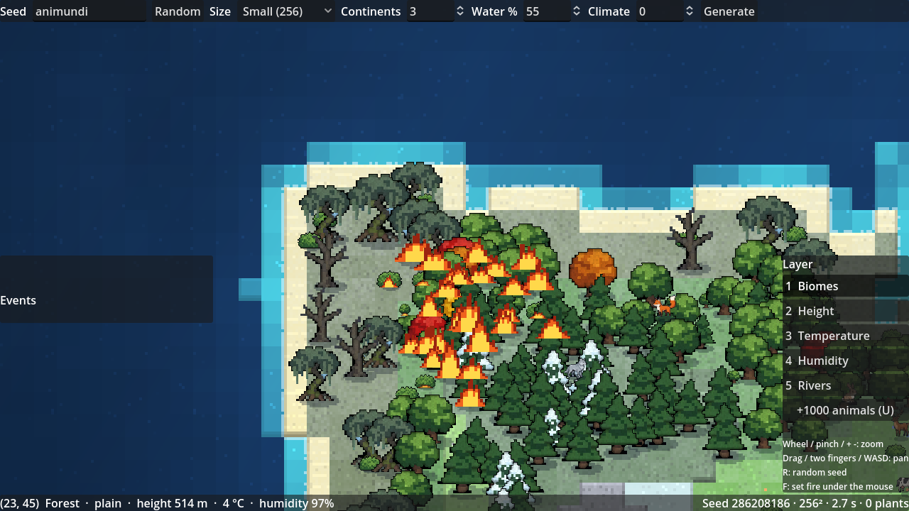
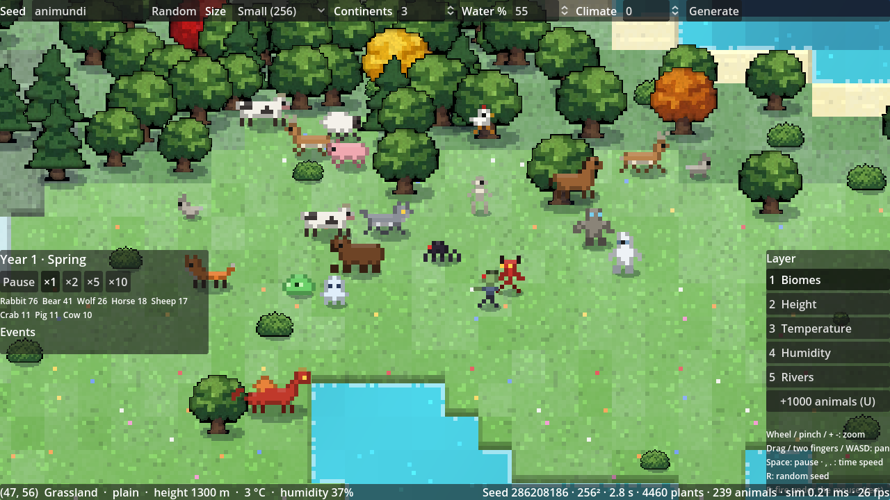
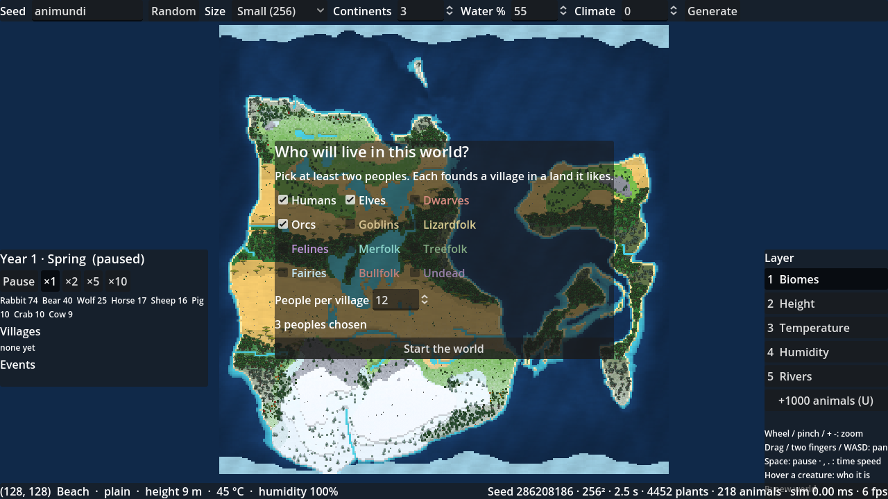
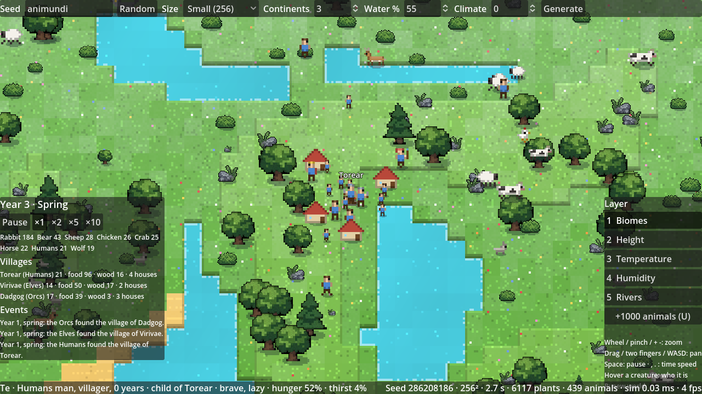
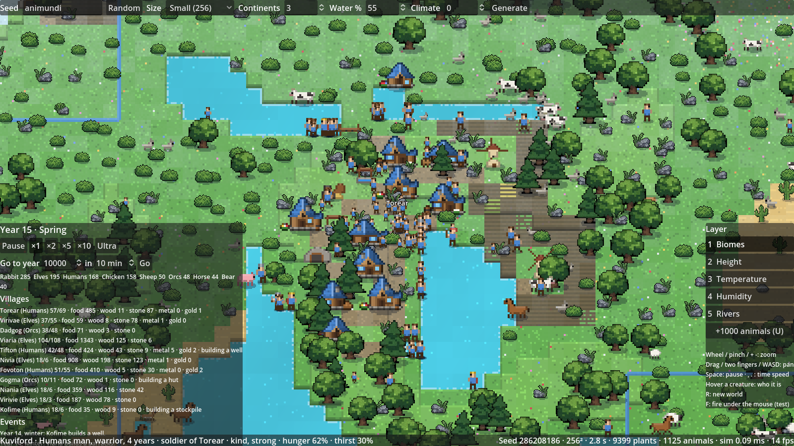
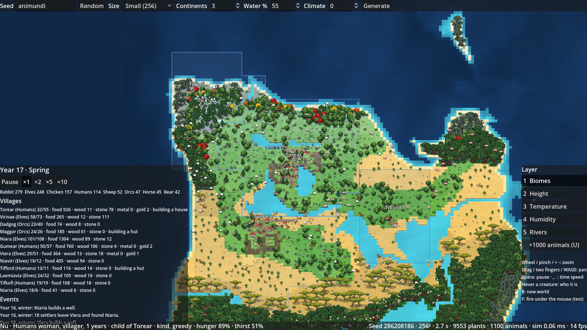
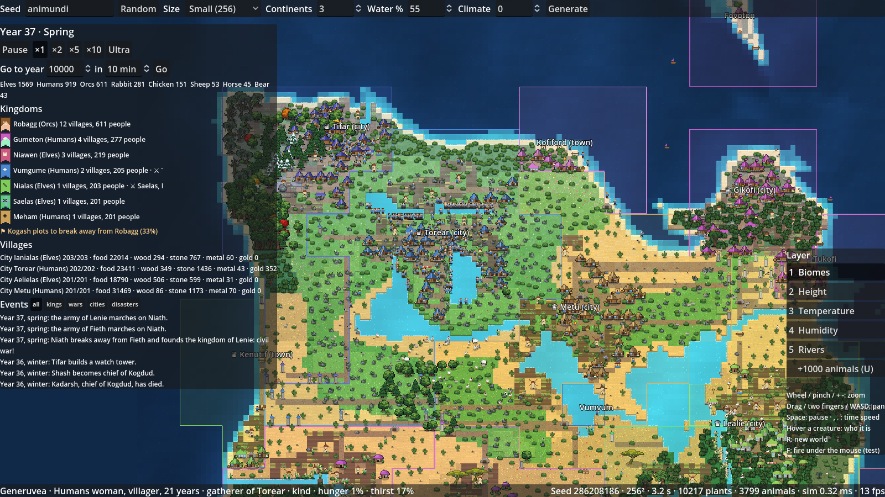
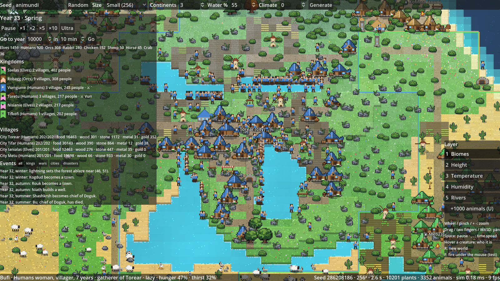
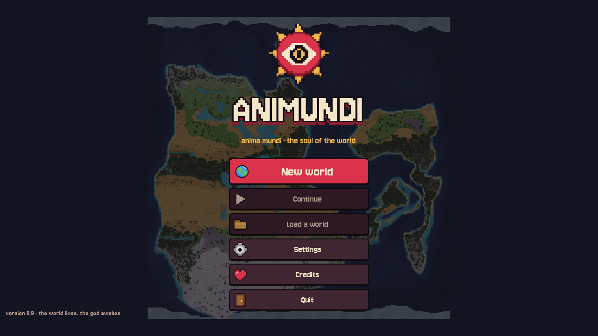
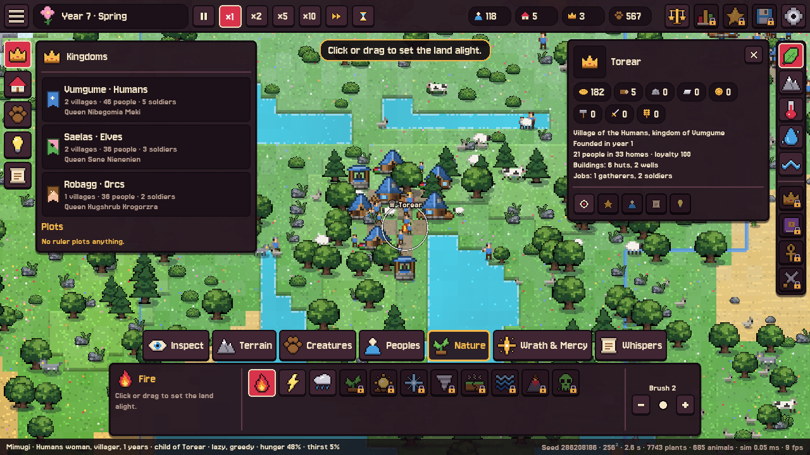

# Animundi

*Anima mundi*: the soul of the world.

A top-down pixel-art god sandbox. You shape a world, drop in peoples, animals and monsters, then watch history write itself.

The twist: every people, monster species and force of nature (forest, volcano, ocean…) is driven by a small AI running locally on your machine. It invents its own culture: items, rituals, laws, architecture, and even the code of its own inventions, written in a small in-game language.

## Status: 0.15 2D core, 0.2 Life, 0.3 Peoples, 0.35 Villages and 0.4 Civilisation


The world is a **flat 2D map drawn as one texture, one texel per tile**, scaled up with sharp pixels: the whole map costs one draw call whatever its size, the way WorldBox does it. Each tile has its biome colour, lighter on higher levels, with a slight variation so big biomes are not one flat colour. Zoomed in, a shader cuts each tile into 8×8 pattern pixels and draws a light ground pattern (grass with single-pixel flowers, forest floor, sand ripples, snow sparkles, rock, glowing lava, water glints) and **step edges** where the ground goes down a level: a dark cliff face on the south side, darker lines on the sides, a light rim on the north. Zoomed out, patterns fade and the map reads like a map.


Every world is generated from a seed with **tectonic plates**: continents grow from clusters of plates, mountain chains rise where plates collide, island arcs form where ocean plates meet, and warped noise gives ragged coasts (see [docs/MAP_GENERATION.md](docs/MAP_GENERATION.md)). Then come climate (latitude, altitude, winds and rain shadows), rivers and lakes, five terrain levels, and natural biomes in large regions. Special biomes (volcanoes, mushroom lands, cursed lands) are never generated at random: the player will place them with the terrain tools, which come with the other god powers once the world lives on its own (see the order of work in [docs/ROADMAP.md](docs/ROADMAP.md)).

Plants (trees, bushes, rocks, cacti, mushrooms, flowers) are scattered over the map by biome from the seed, and **drawn in batches**: every sprite is packed into one atlas texture at start, and all of them go into a few MultiMeshes, one per strip of 16 tile rows, sorted by the height of their feet so nearer sprites cover the ones behind. A 512 world draws its ~22,000 plants in a few dozen MultiMeshes instead of 22,000 draws. Each sprite has a small drawn shadow (no real-time lighting) and tall ones sway in the wind. Zoomed far out, every sprite becomes a crisp dot of its average colour and shadows and flowers are hidden. Water moves: a slow swell of light, twinkling glints and foam coming and going on the shores.

The simulation runs in **C#** (`sim/`), built like WorldBox's: one world object, one manager per kind of entity (creatures and plants for now), zones of 8×8 tiles for spatial queries, and a scheduler running each system at its own rate in batches (walking every step, decisions once a second over 10 batches, nature over slices of the map). Content is data (`data/species.json`, `data/plants.json`).

## 0.2 Life

The world is alive:
- **Time**: pause, or speed up to ×10 to watch years go by. **Seasons**: a year lasts a minute. Plants grow fast in spring and stop in midwinter, and frost creeps over the map from the poles.
- **Plants grow, spread, burn and grow back.** Saplings grow up, grown plants seed their surroundings up to their biome's density, and bare ground is recolonised. Fire lives on tiles, as in WorldBox: each biome has a burn chance and a burn time (`data/biomes.json`), so forests burn through, grassland burns in patches and swamps never burn. Lightning starts wildfires (and **F** under the mouse, as a test tool). They leave ash on the ground, and plants grow back about a year later.
- **Animals have needs.** They graze a layer of grass that regrows, walk to water to drink, rest, and breed when fed and a mate is near. They die of old age, hunger, thirst, predators or fire.
- **Food chains**: wolves, foxes and bears hunt prey of their size or smaller. Each species' habitat feeds only so many, and nature brings scarce species back over time. Migrating species head for the equator in winter. Extinctions show in the events panel, with the time of year and the population of each species.
- **Rules of nature are switches** (world laws: animal spawn, hunger, old age, natural disasters, tree growth), ready for the laws menu.



5,000 animals and 5,000 plants cost about 0.4 ms per simulation step and 2.4 ms per frame to draw on the CPU. `tools/life_check.gd` runs a world for years and prints the populations.

Every living being is **redrawn in pixel art at display size** (`art/creatures.py`), in the spirit of WorldBox: animals, monsters and the 12 peoples in their 4 roles, about a tile tall, with six poses each (idle, two walking steps, attack, swim, death). Creatures walk in steps, strike their prey, and leave remains where they die.



All poses: [docs/images/creatures.png](docs/images/creatures.png).

## 0.3 Peoples



A new world **waits for you to choose who lives in it**: at least two of the 12 peoples, and how many found each village. Then time runs and you watch.



- Each people is a data record (`data/races.json`) that **every world varies**: stats, temperament, speed and lifespan. It also has its own **generated language**: elves are called Rialie or Vivavi, orcs Krazkrash or Dauk, and their villages Virivae or Dadgog.
- Each people founds a **village** in a land it likes, near fresh water: a bonfire, then **houses in its own style** built from wood when room runs out, with stores of food and wood.
- The village hands out **work** by what it lacks:
  - **gatherers** bring wild food from the grass
  - **woodcutters** fell trees
  - **hunters** bring meat
  - **builders** raise houses
  
  Warriors prefer the hunt and fight off beasts. Chiefs and shamans lead, and a new chief rises when the old one dies.
- **Individuals** have a name, sex, age, traits, a partner and parents. They pair up and have children, who grow up and work in turn. Hover a creature to see who it is.
- People decide with a small **utility AI made of neurons**, as in WorldBox: drink, eat, rest, pair, breed, work, play and wander, each with a weight, a cooldown and a priority. Urgent thirst and hunger interrupt anything.
- Village names float over the map, and the left panel lists villages, populations and the events of the world.

`tools/village_check.gd` runs a world with peoples for years and prints how each village fares.

## 0.35 Villages



Villages now do everything WorldBox villages do (the full list, and how each rule maps, is in [docs/VILLAGES.md](docs/VILLAGES.md)):

- **Territory** in zones of 8×8 tiles, claimed as the village grows, with borders drawn in the people's colour.
- **Buildings** from `data/buildings.json`, planned once a month: huts upgraded into houses, stone houses and big houses; stockpile, well, windmill and fields, mine, dock, town hall, barracks and dummies, watch towers, market, temple, library, statue. Homes are drawn in WorldBox's 3/4 style, 4 variants per tier and per people, their roofs in the village's colour ([all sprites](docs/images/buildings.png)).
- **Stores** of food, wood, stone, metal and gold; the blacksmith makes tools and weapons.
- **Jobs** with WorldBox's limits: builders, gatherers, woodcutters, hunters, farmers, miners, fishers, blacksmith, firemen, road builders and soldiers who guard and train.
- **Homes** for everyone; **roads** (faster walking); **fields** whose wheat follows the seasons; wooden buildings **burn** and leave **ruins**.
- Big villages send **settlers** to found new villages of their people.



## 0.4 Civilisation



- Every people starts as a **kingdom** with a capital, a king or queen and a dynasty; its villages wear its colour on their roofs and land, and it has a generated **banner**.
- Rulers **plot**: wars, alliances, peace. Each plot grows for months and is shown before it happens.
- **War**: armies march along land roads on the nearest enemy village, soldiers fight, villages without defenders are **besieged and taken**, kingdoms fall.
- Far, big or conquered villages grow disloyal and **break away**: new kingdoms and civil wars.
- **Trade** routes carry food, wood and stone where they are lacking, by cart or by boat; markets earn gold.
- Settlements grow from **camp to village, town and city**; the event log has **filters** (kings, wars, cities, disasters).



## 0.5 AI minds

Every kingdom has a **mind** that invents, once a year, what its people need: tools, weapons, armour, techniques and buildings, written in a small **invention language** (JSON records the engine validates). Inventions change the world (faster work, bigger harvests, stronger soldiers, homes, food, loyalty), **spread** to neighbours and trade partners, are **forgotten** when useless and **evolve by descent** (most improve one the people know). Invented buildings get sprites assembled from parts in the kingdom's colour. The mind is a **language model built into the game** (llama.cpp compiled in; the model is downloaded once on first launch, or shipped with a build, see [docs/INVENTIONS.md](docs/INVENTIONS.md)); until it is ready, and without it, a procedural inventor invents: the game never waits for it.

## 0.9 God powers (first part)

The player acts on the world from a bar of powers, as in WorldBox (`sim/Powers.cs`, `scripts/ui/power_bar.gd`):
- **Life**: bring any creature (animals and monsters) under the mouse, or found a village of any people on free land, which starts a kingdom of its own.
- **Nature**: fire, lightning, rain (puts fires out, the grass grows back), and a **biome brush** that paints any land biome, mushroom land, cursed land, volcanic rock and lava included.
- **Destruction and mercy**: a meteor the size of the brush, smite, bless (heals and feeds).
- **Whispers**: push two kingdoms to war, to peace or into an alliance by clicking their lands.
- **Inspector**: click a creature or a village to keep its card on screen. **Laws**: switch the rules of the world on and off.

### The interface



The whole interface has one look (`scripts/ui/ui.gd`): dark wine panels with a thick ink outline, bone-white text, crimson and gold, in the mood of Cult of the Lamb, around pixel-art icons and a tabbed bar of powers as in WorldBox. The 81 icons are drawn by `art/ui_icons.py`; creatures, peoples and biomes show their own sprites. The font is Jersey (OFL, `assets/fonts/`).

- **Title screen**, then the **world setup** on the left of the map: the land (seed, size, continents, water, climate: the map is redrawn as you change them) and its peoples.
- **Top bar**: menu, date and season, speed of time and "go to year", the world's numbers (people, villages, kingdoms, animals), laws, settings.
- **Dock** on the left, one book per tab: kingdoms and plots, villages (click one to go there), living creatures, inventions, the chronicle and its filters.
- **Powers bar**: tabs for terrain, creatures, peoples, nature, wrath and mercy, whispers; the chosen power and the brush beside them. **Inspector** card with a portrait, the village's stores and a button to follow with the camera. **Map layers** on the right.
- **Windows**: laws of the world (grouped, one line each), settings (game, display, sound, controls), pause menu (Esc).
- Buttons of features to come are there already, **locked**: more powers (terrain, disasters, miracles, curses…), map layers (kingdoms, cultures, religions, armies), saving and loading, statistics, favourites. Clicking one says what it will do.



Next: 0.6 Culture (AI-shaped values, laws, religions and an AI-written chronicle). God powers come last, once the world lives on its own. The 0.1 3D pixel-art view ([screenshot](docs/images/world_0.1.png)) is retired; its builders in `scripts/render3d/` are still used by the asset sheet tool, and `sprite_library.gd` there sets the sprite sizes.

## Asset sheets

Every sprite, drawn in the game's 3D world with its own look (regenerate with `tools/asset_sheet.gd`):

| Nature, terrain, water | Peoples | Animals and monsters |
|---|---|---|
|  |  |  |

```bash
godot --path . --script res://tools/asset_sheet.gd -- <nature|peoples|creatures> <out.png>
```

## Running the game

Requires:
- [Godot 4.3 **.NET**](https://godotengine.org/download) (the simulation core is written in C#; the standard version can't run it)
- the [.NET 8 SDK](https://dotnet.microsoft.com/download/dotnet/8.0)
- a GPU with Vulkan (the game uses the Forward+ renderer)

1. Open Godot .NET, click **Import**, and pick `project.godot` in this folder.
2. Press **F5** to run: Godot builds the C# project the first time (or run `dotnet build` in this folder).

Controls:

| Action | Input |
|---|---|
| Zoom (toward the mouse) | mouse wheel, trackpad pinch, + / - keys |
| Pan | drag with any mouse button (or click and drag on a trackpad), trackpad two-finger scroll, WASD, arrow keys |
| New random world (then choose its peoples) | R or the dice of the world setup |
| Who is this creature? | hover it |
| Add 1000 wandering animals (stress test) | U or the **+1000 animals** button of the Life book |
| Pause / resume, slower / faster time | Space, comma / period, or the buttons of the top bar |
| God powers | pick a tab then a power in the bar at the bottom, then click the map (drag for fire, rain, smite, bless and the biome brush); Esc goes back to Inspect |
| Menu (the world pauses) | Esc while inspecting, or the button at the top left |
| Brush size | [ and ], or the − and + buttons |
| Follow a creature or a village | with Inspect, click it: its card stays on screen |
| Laws of the world | the scales in the top bar |
| Map layers | 1 Biomes · 2 Height · 3 Temperature · 4 Humidity · 5 Rivers |
| Tile info | hover the map (bottom bar) |

Type any word or number as the seed: the same seed and settings always give the same world.

## Project layout

| Path | Content |
|---|---|
| `scripts/world/` | world settings, data, the generator (shape → climate → hydrology → biomes) and flora placement |
| `scripts/render2d/` | the world map (one texture, one texel per tile), the sprite atlas and sprite batches |
| `scripts/render/` | 2D map renderer (preview tool) and data layer colours |
| `scripts/render3d/` | retired 0.1 3D view (terrain, water, vegetation builders), still used by the asset sheet tool |
| `scripts/ui/` | the interface: its look (`ui.gd`), title screen, world setup, HUD, powers bar, inspector, windows (laws, settings, pause); map camera, and the 0.1 pixel camera |
| `assets/ui/`, `assets/fonts/` | interface icons and emblem (drawn by `art/ui_icons.py`), the Jersey fonts (OFL) |
| `shaders/` | `map.gdshader` (ground patterns and step edges), `sprite_batch.gdshader` (atlas sprites); the others belong to the retired 3D view |
| `sim/` | C# simulation core: world tiles, creatures and their needs (`Life.cs`), peoples and neurons (`Peoples.cs`), villages, buildings and territory (`Villages.cs`), jobs (`Jobs.cs`), kingdoms, diplomacy and rebellions (`Kingdoms.cs`), war (`War.cs`), trade (`Trade.cs`), inventions and minds (`Inventions.cs`, `Minds.cs`), languages (`Language.cs`), seasons, grass, plants and fire (`Nature.cs`), zones, scheduler, data records, drawing (`Draw.cs`) |
| `data/` | content as data records: `species.json` (creatures and the biomes they are born in), `races.json` (the 12 peoples), `plants.json` (plants per biome), `biomes.json` (grass fertility, burn chance and time) |
| `scripts/core/` | seeded random streams, priority queue |
| `scripts/generated/` | files written by `art/sprites.py`, do not edit |
| `assets/tiles/` | terrain atlas used by the game |
| `assets/sprites/` | game sprites: `creatures/` drawn by `art/creatures.py`; trees and plants cut by `art/extract_sprites.py` (the old cut peoples, races, animals and monsters are only used by the 3D asset sheet tool) |
| `art/` | reference sheets (`reference/`), sprite extraction script, old 8×8 sprite generator (not imported by Godot) |
| `tests/` | headless tests |
| `tools/` | headless preview renderer, screenshot, asset sheet, life check and performance check tools |
| `docs/` | game design and research |

## Tests and tools

```bash
godot --headless --path . --import
```

```bash
dotnet build
```

```bash
godot --headless --path . --script res://tests/test_world.gd
```

A world with peoples over the years (villages, stores, homes, buildings, jobs, events):

```bash
godot --headless --path . --script res://tools/village_check.gd -- 10 humans,elves,orcs animundi
```

Living world over the years (populations, deaths by cause, plants):

```bash
godot --headless --path . --script res://tools/life_check.gd -- 10 animundi 256
```

Performance check of the simulation (5,000 animals by default; prints the cost of a step and of drawing a frame):

```bash
godot --headless --path . --script res://tools/perf_check.gd -- 5000 256 300
```

```bash
godot --headless --path . --script res://tools/render_preview.gd -- <seed> <size> <out_dir>
```

Screenshot of the game (needs a display; on a headless machine wrap it in `xvfb-run`). `zoom` is screen pixels per world pixel, a tile being 8 world pixels; 0 shows the whole map:

```bash
godot --path . --script res://tools/screenshot.gd -- <out.png> [seed] [zoom] [setup|village|volcano] [years]
```

To re-cut the game sprites after editing a reference sheet (Python 3, Pillow, NumPy, SciPy):

```bash
python3 art/extract_sprites.py
```

The sprites of every living being (animals, monsters, peoples and their poses) and of the first buildings, with their preview sheets, are drawn by:

```bash
python3 art/creatures.py
```

```bash
cd art && python3 buildings.py
```

The old 8×8 sprites and the 2D terrain atlas used by the preview tool are generated by:

```bash
python3 art/sprites.py
```

## Direction

Animundi is **built like WorldBox** (flat 2D map drawn as one texture, sprites drawn in batches, data-driven content, batched simulation in C#) and **different where it matters**: local AI minds that invent objects, buildings and ways of life, and make them evolve over generations. Version 0.1 was a 3D pixel-art prototype; the game moved to the 2D approach in 0.15 (see [docs/ROADMAP.md](docs/ROADMAP.md)).

## Design

- [docs/GAME_DESIGN.md](docs/GAME_DESIGN.md): everything the game must contain and how it is generated.
- [docs/GOD_GAMES_RESEARCH.md](docs/GOD_GAMES_RESEARCH.md): what other god games let you do, and what Animundi takes.
- [docs/ROADMAP.md](docs/ROADMAP.md): the steps to 1.0, ticked as they land.
- [docs/WORLDBOX_ANALYSIS.md](docs/WORLDBOX_ANALYSIS.md): how WorldBox is built, and what Animundi takes from it.
- [docs/WORLDBOX_WIKI_LESSONS.md](docs/WORLDBOX_WIKI_LESSONS.md): what makes a good sandbox god game, from a study of the WorldBox wiki, and what it means for Animundi.
- [docs/MAP_GENERATION.md](docs/MAP_GENERATION.md): how worlds are generated (tectonic plates, climate, biomes) and the other algorithms looked at.
- [docs/ART_DIRECTION.md](docs/ART_DIRECTION.md): the look of the game (flat 2D pixel art, built like WorldBox) and the history of the 3D prototype.

Engine: Godot 4.3 .NET (GDScript for the map, rendering and interface; C# for the simulation).

## Next steps

See the milestones in [docs/GAME_DESIGN.md § 23](docs/GAME_DESIGN.md#23-milestones). Now: **0.15 2D core** (see the roadmap), then **0.2 Life** (flora spreading, generated animal species, food chains).
