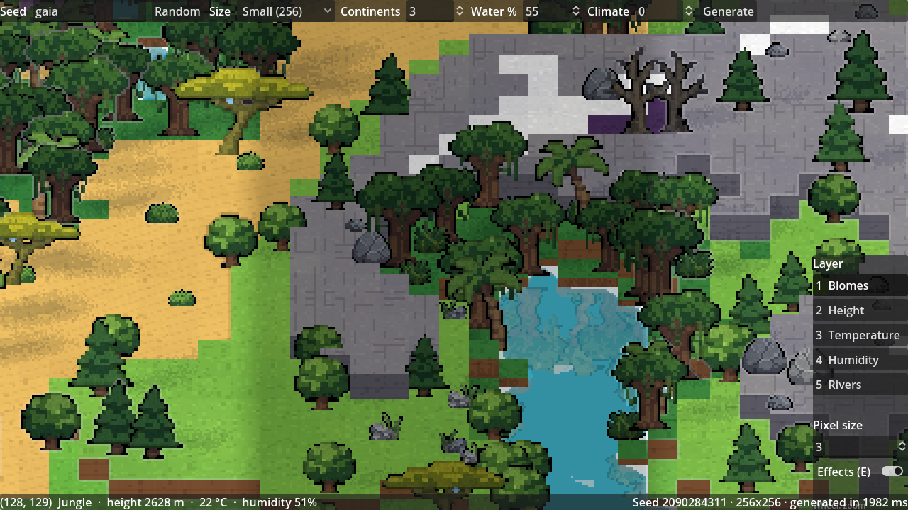

# Animundi

*Anima mundi*: the soul of the world.

A top-down pixel-art god sandbox. You shape a world, drop in peoples, animals and monsters, then watch history write itself.

The twist: every people, monster species and force of nature (forest, volcano, ocean…) is driven by a small AI running locally on your machine. It invents its own culture: items, rituals, laws, architecture, and even the code of its own inventions, written in a small in-game language.

## Status: 0.1 World



The world is a 3D scene of flat terraces on five levels (deep sea, shallow water, plain, hill, mountain) with shadows and water, rendered at low resolution and scaled up with sharp pixels, seen through a fixed tilted orthographic camera. Trees, plants, peoples, animals and monsters are **2D pixel-art sprites standing in that 3D world** ("HD-2D"), cut from the reference sheets in `art/reference/`. Tile tops carry pixel patterns (grass tufts, sand ripples, snow sparkles, rock cracks, moving lava), volcanoes rise as cones with a lava crater, and water is coloured by its real depth, reflects shores, trees and people (mirrored camera), with glints and shore foam.

Every world is generated from a seed: continents, five terrain levels, climate (latitude, altitude, winds and rain shadows), rivers and lakes, and 21 biomes, including volcanoes, mushroom lands and cursed lands.

## Asset sheets

Every sprite, drawn in the game's 3D world with its own look (regenerate with `tools/asset_sheet.gd`):

| Nature, terrain, water | Peoples | Animals and monsters |
|---|---|---|
|  |  |  |

```bash
godot --path . --script res://tools/asset_sheet.gd -- <nature|peoples|creatures> <out.png>
```

## Running the game

Requires [Godot 4.3](https://godotengine.org/download) (standard version, not .NET) and a GPU with Vulkan (the game uses the Forward+ renderer).

1. Open Godot, click **Import**, and pick `project.godot` in this folder.
2. Press **F5** to run.

Controls:

| Action | Input |
|---|---|
| Zoom | mouse wheel |
| Pan | right or middle drag, WASD, arrow keys |
| New random world | R or the **Random** button |
| Map layers | 1 Biomes · 2 Height · 3 Temperature · 4 Humidity · 5 Rivers |
| Pixel size | **Pixel size** box (1 = full resolution, 3 = default) |
| Pixel-art outlines and highlights on / off | E |
| Tile info | hover the map (bottom bar) |

Type any word or number as the seed: the same seed and settings always give the same world.

## Project layout

| Path | Content |
|---|---|
| `scripts/world/` | world settings, data and the generator (shape → climate → hydrology → biomes) |
| `scripts/render3d/` | 3D terrain, water, vegetation and creature builders, shared scene style |
| `scripts/render/` | 2D map renderer (preview tool) and data layer colours |
| `scripts/ui/` | pixel camera and HUD |
| `shaders/` | terrain, water, foliage, grass and outline shaders (banded dithered light, depth, foam) |
| `scripts/core/` | seeded random streams, priority queue |
| `scripts/generated/` | files written by `art/sprites.py`, do not edit |
| `assets/tiles/` | terrain atlas used by the game |
| `assets/sprites/` | game sprites (trees, plants, peoples, races, animals, monsters), cut by `art/extract_sprites.py` |
| `art/` | reference sheets (`reference/`), sprite extraction script, old 8×8 sprite generator (not imported by Godot) |
| `tests/` | headless tests |
| `tools/` | headless preview renderer and screenshot tool |
| `docs/` | game design and research |

## Tests and tools

```bash
godot --headless --path . --import
```

```bash
godot --headless --path . --script res://tests/test_world.gd
```

```bash
godot --headless --path . --script res://tools/render_preview.gd -- <seed> <size> <out_dir>
```

To re-cut the game sprites after editing a reference sheet (Python 3, Pillow, NumPy, SciPy):

```bash
python3 art/extract_sprites.py
```

The old 8×8 sprites and the 2D terrain atlas used by the preview tool are generated by:

```bash
python3 art/sprites.py
```

## Design

- [docs/GAME_DESIGN.md](docs/GAME_DESIGN.md): everything the game must contain and how it is generated.
- [docs/GOD_GAMES_RESEARCH.md](docs/GOD_GAMES_RESEARCH.md): what other god games let you do, and what Animundi takes.
- [docs/ROADMAP.md](docs/ROADMAP.md): the steps to 1.0, ticked as they land.
- [docs/ART_DIRECTION.md](docs/ART_DIRECTION.md): the look of the game. Main inspiration: [David Holland, 3D pixel art rendering](https://davidholland.netlify.app/articles/3d-pixel-art-rendering).

Engine: Godot 4.3.

## Next steps

See the milestones in [docs/GAME_DESIGN.md § 23](docs/GAME_DESIGN.md#23-milestones). Next: **0.2 Life** (flora spreading, generated animal species, food chains).
