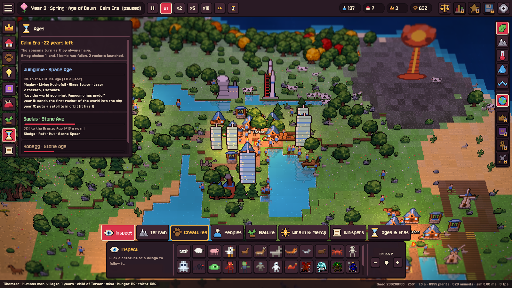

# Ages (0.8)

With 0.8 the peoples no longer stay in the Stone Age. Each kingdom gains **knowledge** and climbs the **ages**, from the Stone Age to the Space Age and the Future, then into ages beyond that no one has seen, named as they are reached. Its **mind** names the things of each age (the ox cart becomes the wagon, the steam train, the motor car...), and its villages, carts and boats change on the map. Progress has a price: **smog**, a **warming** world, the **bomb** and its **winter**. And the world itself has **moods**: eras of a few decades that change the weather, growth and monsters, which the player can bring on.



| | Code | Data | Law |
|---|---|---|---|
| Ages, knowledge, designs | `sim/Ages.cs` | `data/ages.json` | Peoples climb the ages |
| Buildings of later ages | `sim/Villages.cs` | `data/buildings.json` (`age`) | |
| Pollution and warming | `sim/Ages.cs` | `data/ages.json` (`pollution`) | Pollution and warming |
| The bomb, nuclear winter | `sim/Ages.cs` | | Nuclear war |
| Moods of the world | `sim/Eras.cs` | `data/eras.json` | Moods of the world |

The **Ages** book of the dock shows the mood of the world and how long it lasts, the air and the climate, the bombs and the rockets, and a card per people: its age, the way to the next (a bar, and the knowledge it gains a year), the things it makes, its feats. The lineage of its vehicles, ships, homes and weapons is in the card's tooltip. The kingdom cards say each one's age; the top bar says the era. The chronicle has a filter for the ages.

## The ages

| Age | What it opens |
|---|---|
| Stone Age | the start: sledges, rafts, huts, stone spears |
| Bronze Age | the wheel and writing: **vehicles** and **knowledge** in the invention language |
| Iron Age | roads, coins, fortresses |
| Medieval Age | **universities** |
| Renaissance | gunpowder, ocean ships |
| Industrial Age | **factories**, steam trains, steamships; **energy** inventions; smoke |
| Modern Age | **power plants**, cars, liners, blocks of flats; inventions that **clean** the air |
| Atomic Age | **missile silos**: the bomb |
| Space Age | **launch pads**: rockets, satellites, the moon |
| Future Age | hovercars, hoverships, arcologies, orbital cities |
| Beyond | ages without end, each a third dearer than the last, named by the first people to reach it |

- **Knowledge** comes once a year: from the people (the square root of their number: a crowd is not a school), temples, libraries and universities, what the capital knows, trade partners, inventions that teach, satellites. The young learn from those ahead: a people with a neighbour (or a partner, or a foe) further on learns faster. A culture that prizes knowledge learns faster, one bound to tradition slower; war slows it, and so do dark eras and the nuclear winter. What was known once is **found again** faster (the ruins remember).
- **What an age gives**: soldiers strike harder (a rifle against a spear: armour of the same age takes some of the edge off), people work faster, inventions may be stronger, carts and boats go faster, new blocks of the invention language and new buildings open.
- **Falling back**: a capital taken, a library or university burned, the bomb, the nuclear winter cost knowledge. A kingdom whose knowledge runs out drops an age, and goes back to the things of the age before.
- **Rebels** are born in the age of the kingdom they leave, with half its knowledge.
- **The pace**: in a typical world of three peoples, the first reach the Bronze Age around year 20, the Iron Age around 40, the Industrial Age around year 200, the Atomic Age around 300 and space around 450. The ultra-fast speed (×100) and "go to year" are there to watch it. `tools/ages_check.gd` runs centuries without a window and prints how each people climbed.

## Things that evolve

When a people enters an age, its **mind** names the things of that age: its **vehicle**, **ship**, **home** and **weapon**, each grown out of the one before, in the people's spirit. The local model writes a record when it runs (the prompt tells it the age, what the people prize and how they build, and what they used until now):

```json
{ "age": "", "vehicle": "Thunder Wagon", "ship": "Reed Skiff", "home": "Clay Hall", "weapon": "Sun Blade",
  "words": "The wheel turns for us." }
```

- Names have 2-28 letters; `words` is one sentence. A record that breaks the rules is refused and the procedural mind answers.
- The **procedural mind** takes the age's things (`data/ages.json` `designs`) and now and then marks them with what the culture prizes most ("War Motor Car", "Holy Laser", "Living Hovercar") or a word of the people's language.
- **Ages beyond** are named by the first people to reach them: the model's `age` field ("The Glass Dawn"), else words of `data/ages.json` `beyond` ("The Void Exodus").
- Each people keeps the **lineage** of its things: "Sledge → Ox Cart → Wagon → Carriage → Coach → Steam Train → Motor Car...".

On the map the ages show:

- **carts and boats of trade** change with the age: carts, covered wagons, steam trains, motor cars, hovercars; boats, sailing ships, galleons, steamships, liners, hoverships;
- **great homes** (stone houses and big houses) of the later ages: rows of brick houses, blocks of flats, towers of glass, arcologies of domes and gardens, roofs and bands in the kingdom's colour;
- **buildings of later ages**: the university (a dome over columns), the factory (sawtooth roofs, a smoking chimney), the power plant (a cooling tower), the missile silo, the launch pad (a gantry and its rocket).

All are drawn in the sprite atlas (`scripts/render2d/sprite_atlas.gd`, the painters at its end).

## The invention language, by age

| Block | Kinds | Opens in | Effect |
|---|---|---|---|
| `speed` | vehicle | Bronze Age | carts and boats faster (up to 40%) |
| `knowledge` | building, technique | Bronze Age | knowledge a year (up to 12) |
| `power` | energy | Industrial Age | every job faster (up to 30%) |
| `clean` | energy, technique | Modern Age | less smoke (up to 50%) |

The older blocks are open from the Stone Age. A record with a block its people's age has not opened is refused ("beyond their age"). The power a kingdom's inventions may have grows with its age too. The JSON schema and the grammar of the built-in model hold every kind; the prompt lists the kinds and blocks of the people's age.

## The price of progress

- **Smog**: from the Industrial Age, each village fills the air over its land, more with every person and most with factories and power plants; inventions that clean take some off. Smog drifts to the lands around and thins. Where it is thick, grass and plants wither, the ground **blights** (grey, dead earth on the map, in both views), and the spirit of that land grieves the kingdom that owns it ("choked by smoke").
- **Warming**: what goes up stays in the air for a long time. The warmer world has milder winters (less frost on the map), more droughts and wildfires, more floods; scorching eras come more often. Above a degree and a half, snow melts into tundra and ice into water at their edges; above two and a half, tundra greens and savanna turns to desert. The chronicle tells each degree, and the industrial peoples remember it.
- **The bomb**: once a year, a kingdom of the Atomic Age with a missile silo, at war, may drop the bomb on its foe's biggest village: likelier if it loves war, is losing, hates its foe or is weary of the war; a foe that has the bomb too gives pause; a kingdom does not drop two bombs within ten years. Everything in the blast dies, buildings fall (libraries and universities take knowledge with them), the land burns and blights, a mushroom cloud rises, fallout fills the air. The struck people loses knowledge and hates the one who did it; both remember it, and make myths of it (the god of the burning sun, who Unmade the Cities).
- **Nuclear winter**: each bomb puts ash in the sky. Enough bombs in a few years and the sun hides: the land is cold and grey, harvests and growth fail, stores run low, and every people loses knowledge each year until the ash thins.
- **Space**: a kingdom of the Space Age with a launch pad sends a rocket up now and then: its first rocket, satellites (knowledge), the moon, and in the Future Age a city in orbit. Firsts of the whole world are told as such.

## Moods of the world

The world has a mood, an **era** of twenty to forty years (`data/eras.json`). A world begins calm; when an era ends, the next is drawn by its weight, the same mood seldom twice in a row, and a warming world leans to scorching eras.

| Era | What it does |
|---|---|
| Calm | the seasons as they are |
| Bright | plants and harvests grow more, milder cold, fewer monsters, spirits heal faster, peoples learn faster; warm light |
| Dark | less growth, monsters breed, dig lairs and mutate twice as fast, plagues come more often, spirits heal slower, peoples learn slower; a blue dusk |
| Rainy | more growth, fire spreads less, floods instead of droughts; a cool light |
| Cold | frost even in summer, less growth and harvest, fewer wildfires |
| Scorching | droughts and wildfires, poor harvests, little frost; a white-hot light |
| Magical | growth, monsters change faster, spirits heal fast, eruptions, peoples learn faster; a violet light |

- The era's **light** is laid over the map in both views; the ash of a nuclear winter greys it, a warmer sky browns it.
- **The player** brings an era on from the **Ages & Eras** tab of the powers bar: it begins at once and lasts its decades. The peoples feel the world turn.
- With the law **Moods of the world** off, the world stays calm.

## Powers

The **Ages & Eras** tab of the powers bar:

- **Enlighten**: click a kingdom's land: its scholars understand at once (half an age of knowledge, which may take it into the next).
- **Dark age**: click a kingdom's land: it forgets, and falls back an age.
- **Atomic bomb**: click to drop the bomb, by your hand.
- **Eras**: one button per mood of the world; click the map to bring it on.

## Laws

- **Peoples climb the ages**: off, knowledge stops (and nothing is lost).
- **Pollution and warming**: off, the air stays clean.
- **Nuclear war**: off, no kingdom drops the bomb by itself (the player still can).
- **Moods of the world**: off, the world stays calm.

## Checking it

```bash
godot --headless --path . --script res://tools/run_test.gd -- test_ages test_eras test_progress_costs
```

```bash
godot --headless --path . --script res://tools/ages_check.gd -- 500 192 humans,elves,orcs animundi 50
```

```bash
godot --path . --script res://tools/screenshot.gd -- ages.png animundi 3 ages 8
```
