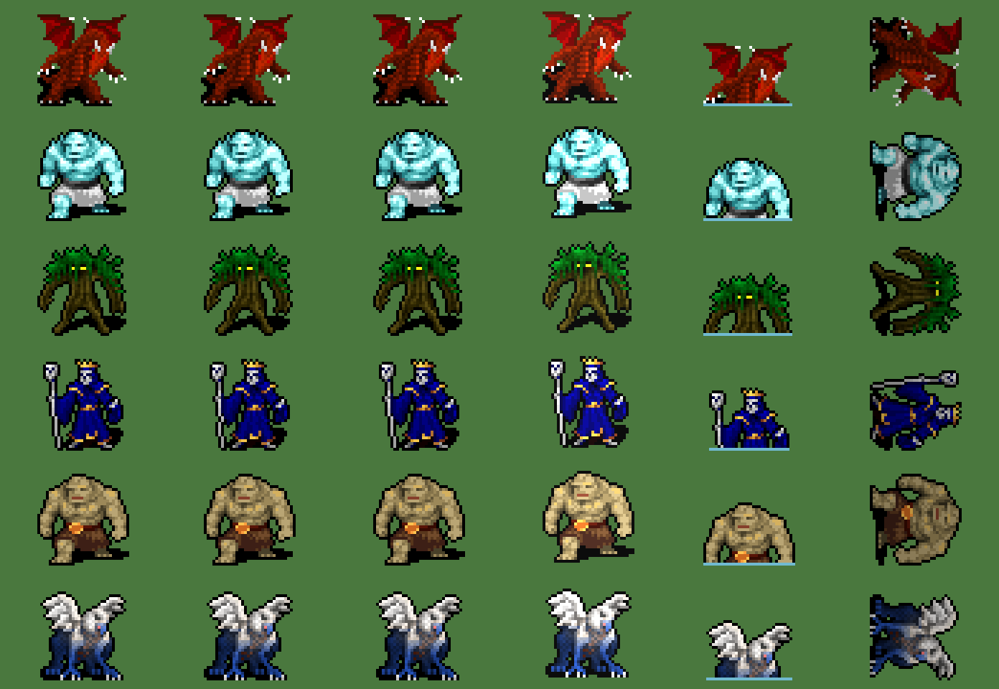

# Legendary monsters (0.7 Monsters and nature)

Common monsters (skeletons, spiders, demons, golems…) are creatures like any other: they are born, hunt and die, and have no mind. A **legend** is different. It is **unique** in its world, has a **name**, a **mind**, and a place in the peoples' lore. Code: `sim/Legends.cs`. Data: `data/legends.json`. Sprites: `art/legends.py`, from CC0 tiles of Dungeon Crawl Stone Soup.



| Legend | Lair | Power | What is told of it |
|---|---|---|---|
| **Ash Wyrm** | volcanic rock, lava, mountains | fire: its strikes set the land ablaze | A great dragon asleep beneath the burning mountains, who wakes to hoard the gold of the peoples. |
| **Frost Titan** | snow, tundra, peaks, taiga | stomp: a wide blow | A giant of the frozen north, older than the first fire. |
| **Elder Treant** | forest, jungle, swamp | roots: it heals as it strikes | The oldest tree of the world, which uproots itself when the forests are in danger. |
| **Hollow King** | cursed land, swamp, taiga | raise the dead: those it slays rise as skeletons | A king who would not die, crowned in bone. |
| **Sand Colossus** | desert, savanna | quake: the widest blow | A giant of sandstone carved with runes no people can read. |
| **Storm Roc** | mountains, peaks, hills | lightning: its strikes start fires | A bird as large as a hall, that brings the storm on its wings. |

## In a world

- When a world is made, the dice decide which legends it holds, from each one's `chance` (about one in two). The world must also have its lair. Each is given a **name** from its syllables ("Vorthak the Ash Wyrm") and a **year to wake** (between its `wake` years). Until then it sleeps: the Legends book only tells rumours ("Something sleeps in the volcanic rock…").
- When its year comes, it **wakes** in its lair, and the chronicle says so. The law **Legends wake** (Creatures) keeps them asleep.
- **The player** can call any legend with the creatures' power (Creatures tab), anywhere on land, at any time. There is only ever one of each: it is refused while that legend walks the world. A slain legend can be called back.
- A legend never ages, hungers or breeds. Flames on the ground do not hurt it. Blades, the player's wrath and lava do.

## Its mind

About twice a year, a legend decides what it does:

| Goal | What it does |
|---|---|
| `slumber` | goes back to its lair and heals there, fast |
| `roam` | walks its lands, within `roam` tiles of its lair |
| `hunt` | eats the nearest beast |
| `raid` | falls on the nearest village of a kingdom within reach. It strikes the people for 22 seconds and takes a third of the gold it finds each time, then leaves. Wounded below a third of its strength, it flees to its lair. |
| `tribute` | names its price in gold. After a while the kingdom pays from its capital, or cannot pay and is raided. |

Its mind is the **local model** when one runs. The model gets the legend's lore, temper, strength, hunger, deeds and the kingdoms within reach (soldiers, gold, those that wounded it). It answers with a record, forced by a grammar or a JSON schema and checked by the engine (`goal`, `target` must be a kingdom within reach for a raid or a tribute, `words` one sentence):

```json
{ "goal": "raid", "target": "Karum", "words": "Your walls are kindling to me." }
```

Otherwise the **procedural mind** decides from its temper:
- wounded → slumber;
- hungry → hunt;
- else wrath and grudges (kingdoms whose warriors wounded it) → raid, greed → tribute, pride → roam, otherwise slumber.

Its words for raids and tributes are told in the chronicle.

**Fights.** Warriors within reach strike it, and in a raid so do the grown people of the village it falls on. It strikes back at whoever stands closest, every 1.6 seconds. Each strike kills up to its `strength` of those who stand there, never another legend.

## In the lore

- Everything it does is told in the chronicle (event filter **Legends**), and an age can be named after it ("The Age of the Wyrm").
- The kingdoms within 40 tiles **remember** its waking, its raids, its tributes, its flight and its death. Their storytellers make **myths** of them, and a people with no god of its domain finds one ("the god of fire who Woke the Wyrm", Religion.cs).
- The warrior who deals it the last blow is **hailed a hero** of their kingdom. The chronicle tells who slew it, and its hoard is left unguarded.
- The **Legends** book of the dock shows who walks the world (what it does, its last words, its deeds), who was slain and by whom, and the rumours of the sleepers. Names float over legends on the map, and the inspector names them.

## Sprites

The legends are **open-source pixel art**: 32×32 tiles from **Dungeon Crawl Stone Soup**, released under **CC0** (public domain) and published on OpenGameArt. They are much more detailed than the 8–19 pixel creatures of `art/creatures.py`, and about four tiles tall in the game. Sources, changes and thanks are in `art/reference/legends/README.md`.

| Legend | Tile |
|---|---|
| Ash Wyrm | the dragon, recoloured in embers |
| Frost Titan | the frost giant |
| Elder Treant | the treant |
| Hollow King | the ancient lich, crowned |
| Sand Colossus | the stone giant, warmed to sandstone |
| Storm Roc | the griffon, recoloured in storm blue |

`art/legends.py` makes every pose from the single tile:
- walking: the lower part steps one way, then the other;
- attack: it lunges forward, brighter;
- swim: cut at the waterline;
- death: fallen on its side, darkened.

`python3 art/legends.py --drawn` draws the legends from shapes instead (shaded materials, dithering, glowing eyes and runes).

```bash
python3 art/legends.py
```

## Tests

`test_legends` in `tests/test_world.gd` checks:
- the sprites;
- the draw of legends and their names;
- the law, waking, and the player's call (only once);
- the procedural mind and the validation of a mind's decision;
- a raid, the myth it becomes, the slaying, and the call back.

```bash
godot --headless --path . --script res://tools/run_test.gd -- test_legends
```
