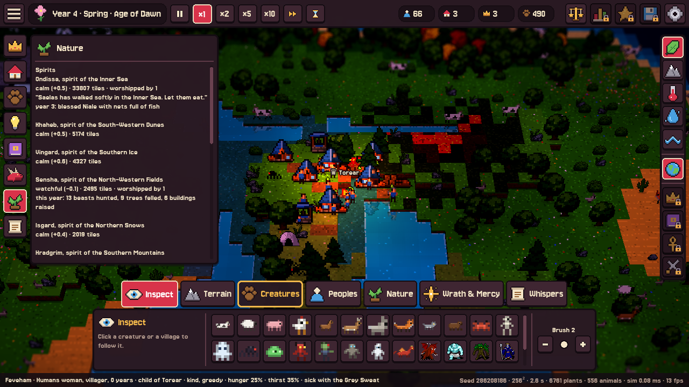
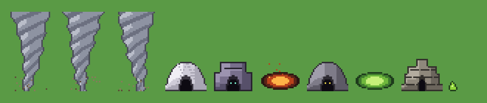

# Monsters and nature (0.7)

With 0.7 the world no longer waits for the peoples to make its history. The land has **spirits** with moods, **disasters** strike, **sicknesses** are born and spread, and common **monsters** dig lairs and change. Everything nature does on its own, the player can do by hand, and every rule is a law that can be switched off. Legendary monsters have their own page: [LEGENDS.md](LEGENDS.md).



| | Code | Data | Law |
|---|---|---|---|
| Disasters | `sim/Disasters.cs` | | Natural disasters, Eruptions and earthquakes |
| Diseases | `sim/Plagues.cs` | `data/diseases.json` | Plagues |
| Nature spirits | `sim/Spirits.cs` | `data/spirits.json` | Nature spirits |
| Monsters | `sim/Monsters.cs` | `data/monsters.json` | Monsters change |

The **Nature** book of the dock shows all of it: spirits and their moods, disasters, sicknesses, monsters and lairs. The chronicle has a filter for what spirits and monsters do (**Spirits and monsters**); disasters and plagues are told under **Disasters**.

## Disasters

Each disaster is one action with three triggers: nature itself, an angry spirit, and the player (Nature tab of the powers bar).

| Disaster | What it does |
|---|---|
| **Earthquake** | Buildings fall to ruins (stone more than timber), people are crushed, lairs cave in. |
| **Eruption** | Lava bursts out and flows for half a minute, downhill first. It kills what it reaches (but creatures of the fire), buries buildings, fields and roads, and lights the land around. Ash falls far around. Two years later the lava cools into volcanic rock. Demons may crawl out of it. |
| **Flood** | The lowest land around the water goes under for about twenty seconds (with no water near, a cloudburst floods the hollow). Creatures drown, wheat is lost, wooden buildings are swept away, fires go out. The silt it leaves is green. |
| **Tornado** | A whirlwind wanders for twenty to thirty seconds, turned back by the sea. It throws creatures, kills some, uproots plants and tears buildings down. |
| **Drought** | For a year or more, the grass withers and nothing grows or seeds, wheat stops growing, fire spreads far more easily and breaks out by itself in summer. Rain (the player's, or a spirit's gift) ends it. |
| **Wildfire** | A great fire breaks out in woods or grass that can burn. |

- **On its own**, nature strikes every one and a half to four and a half years, not before year 3. The season weighs: tornadoes in spring and summer, floods in spring and autumn, droughts and wildfires in the hot months. Half the time it strikes near a village. Eruptions only happen where there is volcanic rock or lava: a fresh world has none, so they come with the volcanoes the player raises (or a mountain spirit's wrath).
- Flooded land and parched land show on the map, in both views.
- The kingdoms that see a disaster **remember** it and make myths and gods of it ("the god of the deep earth who Shook the World"). When the player caused it, they know whose hand it was.

## Diseases and plagues

A disease is drawn the day it breaks out, from `data/diseases.json`:

- a **symptom**: fever (the sick thirst twice as fast), cough (it carries further), wasting (they hunger twice as fast), shakes (they are weak and wounded), rot (some of its dead rise as zombies);
- a **name** of its own, from an adjective and one of the symptom's nouns: "the Red Cough", "the Weeping Rot";
- who **carries** it: people, beasts, or all. The undead, golems and legends never sicken;
- its numbers, drawn between the symptom's bounds: how easily it passes, the share of the sick it kills, how long it lasts;
- its **cure**: *herbs* (a village with a shaman loses far fewer, and they heal faster), *quarantine* (a village with a fifth of its people sick shuts its gates, and it passes four times less there), or none.

It passes from the sick to those who stand close. Those who get over it never catch it again, so a sickness burns through a village and dies out; after five years it weakens anyway. Carts and boats of trade carry it from village to village, unless the gates are shut. An old sickness may come back years later.

- **On its own**, a sickness breaks out every ten to twenty-two years (the first after year 6), in a crowded village or among the beasts of a thriving species.
- A disease that has killed ten people is a **plague**: the chronicle counts its dead (10, 50, 200) and the kingdoms it struck remember it.
- The sick wear a green drop over their heads; the inspector names their sickness; the Villages book counts each village's sick.
- **The player**: *Plague* gives the creatures under the brush a new sickness that all can carry; *Heal* cures the sick and closes wounds.

## Nature spirits

When a world is made, each large stretch of forest, sea, mountains, plains, desert, swamp or snow gets a spirit of its own (two at most of each kind, nine in all), with a name and a place: "Sylwen, spirit of the Northern Woods". A volcano the player raises gets its spirit within a year.

A spirit has a **mood**, from wrathful (−1) to content (1).

- **What grieves it**, in its lands: trees felled, land burned, beasts hunted, buildings raised and standing, mines dug (mountains), docks (the sea), the player's meteors and disasters. It knows which kingdom did it. A wide land bears more than a small one.
- **What heals it**: time, and the kingdoms around that worship nature or have a god of its domain.

Once a year its mood moves. Then, unless it acted in the last years, its **mind** decides:

| Act | When | What happens |
|---|---|---|
| `rest` | | nothing |
| `warn` | angry (below −0.2) | an omen over a village of the kingdom it blames; their faith grows |
| `punish` | angry | one of the wraths of its kind falls on that kingdom's village. Its wrath is spent and the debt paid. |
| `bless` | not angry (0 or more) | the gift of its kind, to a kingdom near its lands (one that worships it first) |

| Spirit of | Wrath | Gift |
|---|---|---|
| the forest | its beasts, overgrowth (the wheat is lost, saplings sprout all over the village) | a rich hunt and harvest |
| the sea | flood, storm | fish |
| the mountains | earthquake, eruption | ore (stone and metal) |
| the plains | tornado, drought | a flowering of the land, ripe wheat |
| the desert | drought, tornado | rain (ends droughts) |
| the swamp | a sickness, its beasts | healing herbs (the sick of the kingdom rise) |
| the snows | its beasts, storm | a rich hunt |
| a volcano | eruption, wildfire | a flowering of the land |

Its mind is the **local model** when one runs. It is given the spirit's nature, mood, the year's wounds, its past deeds and the kingdoms near (how they treat nature, the harm each did, whether they worship it), and answers with a record forced by a grammar or a JSON schema and checked by the engine:

```json
{ "act": "punish", "target": "Karum", "words": "I warned Karum. I do not warn twice." }
```

A spirit at peace cannot punish, an angry one cannot bless, and the target must be a kingdom near its lands. Otherwise the **procedural mind** decides: wrathful (below −0.55), it punishes the kingdom it blames most; angry, it warns it; content (0.6 and more), it blesses; else it rests.

What a spirit does to a kingdom is remembered there and becomes a myth and a **god of its domain**: spirits are worshipped as gods, and worship calms them.

## Monsters that change

Legends have a mind each. Common monsters (`data/monsters.json`: spiders, skeletons, ghosts, slimes, demons, zombies, golems, yetis, dragons) have one **per species**. A fresh world still has no monsters: they come from the player's hand, from special biomes, and now from events.



**Lairs.** Where four monsters of a kind live and three stand together, they make a lair: a spider nest, a crypt, a fire pit, a cave, a spawning pool, a cairn.
- A lair left alone **grows** (new, grown after four years, great after eight) and brings new monsters, the faster the larger it is: even those that do not breed. Three lairs per species at most, fourteen in a world.
- The warriors of the nearest village (within 16 tiles) **burn it out** when they outnumber its guards by two; some may die doing it, and their kingdom remembers the deed.
- The player's meteors and lightning, earthquakes, whirlwinds and lava destroy lairs too.

**Mutations.** Once six of a species live, it changes every six to twelve years: it takes one of the mutations of its pool, once each.

| Mutation | Effect |
|---|---|
| Venomous | people fight it off far less often |
| Giant | larger (drawn larger), no prey too big, a little slower |
| Swift | faster, ranges further |
| Swarming | larger litters, lairs spawn faster |
| Iron-hided | harder to fight off, lives longer |
| Burning | what it kills catches fire |
| Plague-bearing | its bite carries a sickness of its own ("the Zombie Fever") |
| Cunning | harder to fight off, ranges further |

The species takes a new **name** ("Venomous Spider", then "Swift Venomous Spider"), and the chronicle and the Nature book keep its lineage. The local model chooses the mutation and may name the strain itself (`{ "mutation": "venom", "name": "Ashfang Spider" }`, validated). Otherwise the procedural mind answers what presses the species: hunted by the peoples, it grows harder to kill; starving, faster or bigger; few, it breeds more. A new world gets the species as they were.

**Events that bring monsters.** The dead of a rotting plague may rise as zombies; demons may crawl out of an eruption; ghosts haunt half the villages that are abandoned.

## Tests and tools

`test_disasters`, `test_plagues`, `test_spirits` and `test_monsters` in `tests/test_world.gd`:

```bash
godot --headless --path . --script res://tools/run_test.gd -- test_disasters test_plagues test_spirits test_monsters
```

`tools/nature_check.gd` runs a history without a window and reports what nature did in it:

```bash
godot --headless --path . --script res://tools/nature_check.gd -- 100 192
```

`tools/screenshot.gd` has a `nature` scene (a whirlwind, a flood, an eruption, a sickness and a lair around the first village).
