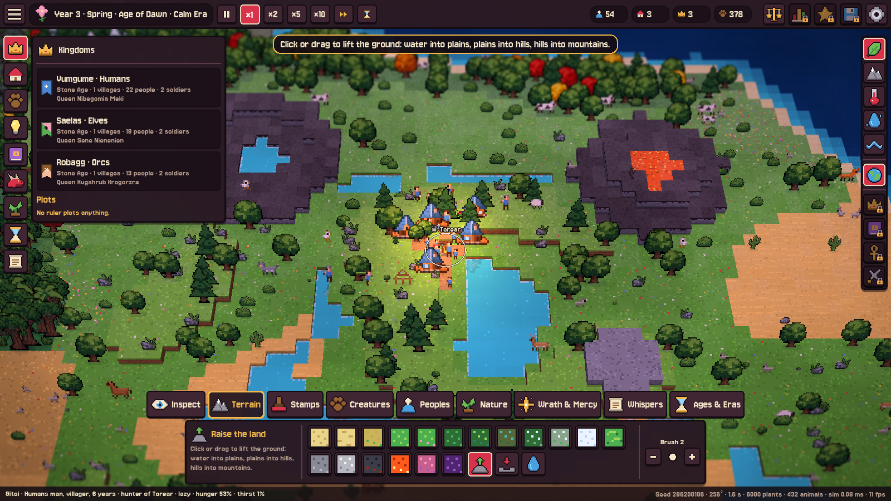
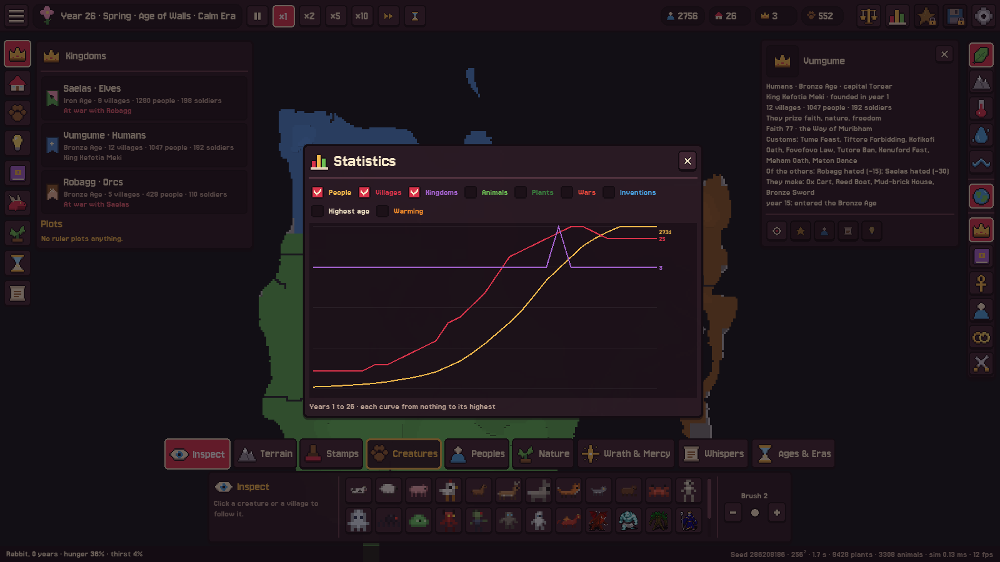

# God powers and interface (0.9)

With 0.9 the player gets the rest of the god powers: the land itself (raise, lower, water, stamps of one's own), more weather and wrath, powers that act on minds, and an interface that shows the world: cards for kingdoms, species, spirits and inventions, political map layers, statistics, a code to share a world, and a law for every rule.



| | Code | Interface |
|---|---|---|
| Terrain tools and stamps | `sim/Terrain.cs` | Terrain and Stamps tabs; `scripts/world/stamp_store.gd` keeps the player's stamps |
| Sparks, seeds, blizzard, curse, madness, resurrection, powers on minds | `sim/MorePowers.cs` | Nature, Wrath & Mercy, Whispers tabs |
| Cards, political layers, statistics | `sim/Cards.cs` | `scripts/ui/inspector.gd`, layer buttons, `scripts/ui/stats_window.gd` |
| World codes | `scripts/world/world_settings.gd` | the world setup panel |
| Laws | `sim/Life.cs` (Laws) | `scripts/ui/laws_window.gd` |

## The land

The world has five levels: deep sea, shallow water, plain, hill, mountain. After every change the levels around are fixed so the terrain stays as valid as a generated one: two land neighbours differ by one level at most, the land at the water's edge is a plain, and deep sea never touches land. A tile that changes level takes the biome of its new height (hills, mountains; a new plain keeps its biome or takes its neighbours'). What stood on land that goes under drowns: creatures, plants, buildings, fields and roads. Water sources and the lands where creatures are born are worked out again. The flat map and the tilt view redraw only the tiles and chunks that changed.

- **Raise the land** (drag): water becomes plain, plains hills, hills mountains; the land around rises with it.
- **Lower the land** (drag): down to the water, which comes in (the sea if it touches the sea, else a lake).
- **Water** (drag): on land, pours a lake (the banks come down to the plain); on water, dries it into land.
- **Stamps**: ready-made pieces of land pasted where the player clicks: a small volcano and a great one (lava at the heart, volcanic rock around; they get their spirit), an island (out of the sea, forest, grass and beach), a crater (a lake in a ring of rock), an oasis (a lake, jungle, savanna in the desert), a mountain, a lake.
- **Copy the land**: keeps the square under the brush (6 to 32 tiles across) as a stamp of one's own, saved in `user://stamps/` and listed in the Stamps tab of every world from then on. Biomes are kept by name, so a stamp works in any world.

## More powers

| Power | Tab | What it does |
|---|---|---|
| **Fire** | Nature | now throws sparks that arc out and light the land they fall on, as in WorldBox |
| **Seeds** | Nature | sows the plants of each tile's biome under the brush, heals ash |
| **Blizzard** | Nature | frost for half a year (white on the map, nothing grows), fires out, lakes freeze at the edges, the cold kills some of the creatures caught in it |
| **Curse** | Wrath & Mercy | for a year and a half, those under the brush hunger and thirst faster and strike weaker |
| **Madness** | Wrath & Mercy | creatures under the brush turn on the nearest creature, kin or not, for 25 seconds |
| **Resurrect** | Wrath & Mercy | the dead still lying under the brush rise: beasts as they were, people as zombies |
| **Rebellion** | Whispers | a village (not a capital) breaks away from its kingdom |
| **Inspire** | Whispers | a kingdom's mind has an idea and invents at once |
| **Forget customs** | Whispers | a kingdom forgets its customs, tales and memories; its values drift to the middle |
| **Forget faith** | Whispers | a kingdom's gods are forgotten and a new faith is born there |
| **Traits** | Whispers | brave, lazy, kind, greedy, wise or strong, rained on the people under the brush |

Hail and wind, faith mode, forgetting a language and the storyteller came with 1.0 ([POLISH.md](POLISH.md)).

## Seeing the world

- **Cards**: click a kingdom in the Kingdoms book, a species in the Life book, an invention in the Inventions book, or land with no village (its spirit), and the inspector keeps its card, refreshed while it lasts:
  - a kingdom: people, age, capital, ruler, villages, people and soldiers, what it prizes, faith and creed, customs, wars and allies, what it thinks of the others, the things it makes, what it makes of the player, its last feats;
  - a species: how many, how many the land feeds, diet and size, lifespan and speed, where it is born, how it has changed;
  - a spirit: its land, mood, wrath and gift, what grieved it this year, its words and deeds;
  - an invention: who made it and when, its effects, the villages that know it, whether the model wrote it, its **record** in the invention language and its **lineage**.
- **Political map layers** (the buttons under the data layers, in both views): kingdoms, cultures (a colour from what they prize most), religions (a colour per faith), peoples, alliances (a colour per group of allies), wars (kingdoms at war in red, the front brighter; on the flat map, a line between the capitals of each war). Land no one owns is grey.
- **Statistics** (top bar): people, villages, kingdoms, animals, plants, wars, inventions, the highest age and the warming, a line a year, each curve from nothing to its highest.
- **A world's code**: the world setup copies the code of the world (`AM1:` and the settings) to share it; paste one, or type it in the seed box, to make the same world.



## Laws

Every rule of the simulation has its switch: animals born over time, plants growing, seasons, hunger and thirst, old age, legends, monsters, spirits, the moods of the world, pollution, natural disasters, fire spreading, plagues, eruptions, kingdoms plotting, rebellions, settlers, minds inventing, trade, customs and myths, faiths, the ages, nuclear war.

## Saving

Saving and loading a whole world (everything that lives in it) came with 1.0 ([POLISH.md](POLISH.md)). A world's code gives back its land only.

## Checking it

```bash
godot --headless --path . --script res://tools/run_test.gd -- test_terrain test_more_powers test_world_views
```

```bash
godot --path . --script res://tools/screenshot.gd -- terrain.png animundi 3 terrain 2
```

```bash
godot --path . --script res://tools/screenshot.gd -- views.png animundi 0 views 25
```
